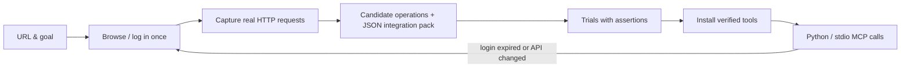

# Web2MCP

[](https://github.com/xuexying/web2mcp/actions/workflows/ci.yml)
[](LICENSE)
[](pyproject.toml)

**Record a web app once in your browser. Call it forever without one.**

Turn the web apps you already log into into MCP tools. Read-only by default; writes need a reviewed contract.

English | [简体中文](README.zh-CN.md)

```sh
pip install git+https://github.com/xuexying/web2mcp
web2mcp inspect site.har
web2mcp discover site.har --out my-profile --origin https://api.example.com --read-only-safe
```

- **No browser at call time.** Tools send plain HTTP requests learned from your recording; the browser is only needed to explore, log in and re-verify.
- **Writes are guarded.** Every write is previewed, needs explicit approval, is read back from the server to verify the business result, and is protected by a persistent duplicate-submission lock.
- **"Captured" is never treated as "verified".** Observed requests are candidates; tools are published only after trials with assertions pass.

> Not to be confused with [WebMCP](https://github.com/webmachinelearning/webmcp), a W3C draft that lets *site authors* expose in-page tools. Web2MCP works from the outside, on recorded traffic of sites you are authorized to use — no site cooperation required.

## How it works



The capturer records what actually happened, packs describe how to call it, and the executor sends requests under constraints. The optional autopilot layer only orchestrates this flow — a model never generates arbitrary code for direct execution.

## How to export a HAR

Log into the target site in any browser, do the few actions you care about, then save the traffic:

- **Chrome / Edge**: DevTools (F12) → Network tab → right-click any request → *Save all as HAR with content*.
- **Firefox**: DevTools → Network tab → gear icon ⚙ → *Save All As HAR*.
- **Safari**: enable the Develop menu, then Develop → Show Web Inspector → Network tab → *Export*.

**Phone and desktop apps** (not just browsers): route the app through [mitmproxy](https://mitmproxy.org/) with its CA certificate trusted, then export a HAR (`File → Export → HAR`, or run `mitmweb`/`mitmdump` with `--save-har out.har`). mitmproxy emits standard HAR 1.2, which `web2mcp quick` / `discover` consume directly — so a phone app or an Electron desktop app integrates the same way a website does. Only capture apps and accounts you are authorized to automate.

The HAR carries your login state (cookies), so treat the file as a credential and keep it out of version control.

## What you get

Running `discover` on a capture produces a private profile directory containing:

- **An MCP server** (`web2mcp serve <profile>`, stdio transport) plus a ready-to-paste `mcp.json`.
- **A generated Python client** (`client.py`) with one method per operation.
- **An OpenAPI 3.1 spec** (`openapi.json`) describing the observed surface, including read/write annotations and RPC variants.
- **A hash-chained local audit log** of every call, with sensitive values redacted.

## Try it fully offline

```sh
git clone https://github.com/xuexying/web2mcp.git
cd web2mcp
python3 -m venv .venv && source .venv/bin/activate
python -m pip install -e '.[test]'
python examples/demo.py --verbose
python -m pytest -q
```

The demo spins up a fictional loopback-only purchase system, captures samples, builds a profile, then — over a real MCP stdio connection — reads a record, previews an approval, approves once, verifies the result by reading it back, and blocks the duplicate submission. All data is synthetic; no real AI or browser is involved.

## Ways in

### 1. Record in one command (`web2mcp record`)

The shortest path from a URL to a read-only MCP server, on macOS, Linux and Windows. Needs the optional recorder:

```sh
pip install 'web2mcp[record]'
playwright install chromium
web2mcp record https://app.example.com --out work/site
```

A Chromium window opens; log in and click through the parts you care about, then **close the window** to finish. The recorded traffic becomes `work/site/capture.json`, and `record` prints the per-origin summary and a ready-to-paste `discover` command. You type passwords and verification codes yourself in the window — any request carrying a password-like field is dropped before anything is written, and the raw recording is deleted after conversion. Then:

```sh
web2mcp discover work/site/capture.json \
  --out work/site-profile --origin https://api.example.com --read-only-safe
web2mcp serve work/site-profile
```

### 2. Import a HAR (stable)

Works on any OS with any browser and no extra tooling at all. Only use captures of sites and accounts you are authorized to automate.

**Fastest path — `web2mcp quick`:** inspect, auto-pick the API origin, build a read-only-safe profile and print a paste-ready MCP config, in one command. It proceeds automatically when there's a single clear API origin, and stops to let you choose with `--origin` when there are several:

```sh
web2mcp quick work/site.har
```

Prefer the explicit steps? Not sure which `--origin` to pass? `inspect` shows per-origin operation counts, read/write split and login presence, and prints a ready-to-paste `discover` command (third-party/analytics hosts are flagged and excluded):

```sh
web2mcp inspect work/site.har
```

One step to a **safe read-only** MCP server — only read tools are exposed, every write is hidden and blocked at the execution layer (`read_only_mode`):

```sh
web2mcp discover work/site.har \
  --out work/site-profile --origin https://api.example.com --read-only-safe
web2mcp serve work/site-profile
```

HAR import reconstructs the cookie snapshot from request/response headers, so **your login travels with the HAR** — cookie-authenticated sites work immediately. Add `--policy examples/policy.json` (adapted to your actual endpoints) to name tools and mark read/write semantics explicitly; HTTP method alone is not sufficient and side-effect paths (logout/export/approve/…) are never auto-classified as reads.

To enable writes: review semantics, then use `trial-read` / `publish-reads`, or the pack flow `draft-pack` → `check-pack` → `trial-pack` → `install-pack`, and install a reviewed write contract. Full walkthrough in [docs/INTEGRATION.md](docs/INTEGRATION.md); pack syntax in [web2mcp/pack_reference.md](web2mcp/pack_reference.md).

**Just one endpoint?** Paste a DevTools "Copy as cURL" (bash) command and add that single operation to a profile — no HAR needed:

```sh
pbpaste | web2mcp add-curl work/site-profile      # macOS; use your clipboard tool of choice
```

Repeated `add-curl` calls accumulate into the same profile; the real response shape is filled in later by a `trial-read`.

**Already have an OpenAPI spec?** Build a profile straight from it, no capture needed — web2mcp's job becomes adding a reviewed write-safety layer on top of an API you already have:

```sh
web2mcp import-openapi api-spec.json --out work/api-profile      # OpenAPI 3.x JSON
```

Reads are exposed read-only-safe by default (add `--writes` to expose writes too). The spec carries no credentials, so add them to the profile's private `credentials.json` — the reported security schemes say what's needed — then `trial-read` tightens the placeholder response shapes.

### 3. AI-driven browser exploration (experimental)

Needs a browser backend, selected with `--backend` (default: auto):

- `playwright` — bundled Chromium, cross-platform (`pip install 'web2mcp[record]'`).
- `ego` — [ego-browser](https://github.com/citrolabs/ego-lite) (optional; free; macOS and Windows).
- `cdp` — attach to a Chrome you started with `--remote-debugging-port=9222`, reusing its live login.

```sh
python -m web2mcp explore-start work/exploration \
  --url https://example.com --backend playwright \
  --goal 'read the task list and details, verify two different tasks'
python -m web2mcp serve-explorer work/exploration
```

A connected AI observes pages, drives bounded reviewed UI actions, drafts candidate configs, runs trials and installs tools. You complete logins yourself in the browser — the program never receives passwords or verification codes. `source-map` / `explore-survey` / `synth-profile` can map an app's API surface from its shipped JavaScript plus runtime capture; synthesized profiles default to `read_only_mode`. (The HAR path and `web2mcp record` need no backend at all.)

### 4. Autopilot integration service (experimental — not yet validated on a real site)

A local HTTP API accepts a URL and a goal; a configurable model plans exploration, trials, questions and publishing. The loop and its safety gates are covered by tests with a simulated model, but **no real model has yet driven a real site end to end** — see [ROADMAP.md](ROADMAP.md).

```sh
cp model.example.json model.local.json   # set endpoint/model; API key via WEB2MCP_MODEL_API_KEY
python -m web2mcp serve-integrations work/integrations \
  --model-config model.local.json --port 8766
```

The service listens on `127.0.0.1` only and requires a local bearer token (path printed at startup). Jobs pause with `waiting_user` for logins, business choices and every write authorization.

| API | Purpose |
| --- | --- |
| `POST /v1/integrations` | Create an integration job |
| `GET /v1/integrations/{id}` | Progress and pending questions |
| `POST /v1/integrations/{id}/responses` | Answer questions / approve specific actions |
| `POST /v1/integrations/{id}/pause` · `/resume` | Pause after the current step; resume with a bounded budget |
| `GET /v1/integrations/{id}/mcp-config` | MCP config for the verified tools |

## Connect from MCP clients or Python

Each profile ships an `mcp.json`; or configure manually:

```json
{
  "mcpServers": {
    "my-product": {
      "command": "/absolute/path/to/.venv/bin/python",
      "args": ["-m", "web2mcp", "serve", "/absolute/path/to/profile"]
    }
  }
}
```

```python
from web2mcp import Product

with Product("work/site-profile") as product:
    print(product.tools())
    result = product.call("my_product__read", {"id": "123"})
```

## Limits & responsible use

**Only use Web2MCP on sites and accounts you are authorized to automate.** Check the terms of service of the product you integrate; prefer an official API where one exists.

- When a site deploys anti-automation protection (CAPTCHAs, proof-of-work challenges, device binding), the right behavior is to detect it, stop, and tell you the site is not supported this way — not to bypass it.
- Capture files can contain credentials and business payloads. Profiles, sessions, diagnostics and audit logs are private local runtime data; never commit them (the shipped `.gitignore` covers the defaults).
- If you configure a model, page content and business samples from the exploration context may be sent to that model service. Use a model environment you trust with that data.
- Writes are never retried automatically. On timeouts or ambiguous results the state is preserved and execution stops; the duplicate-submission lock does not replace upstream idempotency guarantees.
- Credentials expire. Re-capture and run `refresh-login` / `refresh-storage`; a live identity probe must pass before credentials are updated. There is no generic automatic token renewal for arbitrary sites, and unknown signature schemes are never replayed blindly.
- On Windows, credential files rely on user-profile ACLs rather than POSIX `0600` permissions.
- Not built in: site-specific signature algorithms, WebSocket protocols, file uploads, streaming responses. These need reviewed adapter extensions.

## Project layout

```text
web2mcp/          executor, discovery, contracts, browser bridge, job orchestration
examples/         fictional local product, end-to-end demo, JSON pack samples
tests/            regression tests; no production accounts involved
docs/             integration guide and demo assets
model.example.json  model config template without keys
```

## License

[MIT](LICENSE).
