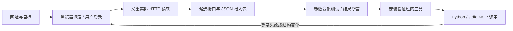

# Web2MCP

**第一作者 / First author: xueying**

**让 AI 从浏览器里的实际操作中学习接口，把验证过的操作转成可复用的 Python 调用与 MCP 工具。**

浏览器用于探索、登录和验证。完成接入后，工具直接发送 HTTP 请求，通常不需要再次操作页面。登录过期或网站协议变化时，再回到采集与验证流程。

这是可运行的通用框架原型：支持请求发现、源码级接口测绘、配置式接入、读写验证、标准 MCP 服务和可配置模型的自动接入任务。**不保证输入任意网址即可自动完整接入，也不把捕获到接口等同于验证成功。**

此仓库只包含通用源码、合成测试数据和本地演示站。具体企业系统的适配器、业务契约、域名、真实单据、会议、消息、登录会话及运行记录均未包含。

## 能做什么

| 能力 | 当前实现 |
| --- | --- |
| 请求采集 | 通过 Ego 浏览器探索并记录 HTTP 请求；也可导入 HAR 1.2 |
| 主动勘察 (survey) | 自主沿站内链接与导航元素（标签/菜单/侧边栏）遍历，只读捕获各视图的接口；绝不点写/提交/删除按钮，可在登录态站点安全运行 |
| 源码接口地图 (source-map) | 下载应用自身发布的 JavaScript（入口 + 递归跟随构建产物里的分块引用抓全路由块），静态提取端点、方法、读/写分类；对自定义 HTTP 封装的端点名另列候选 |
| 接口发现 | 合并多个样本，推断字段结构、路径参数和候选工具；观测结果不冒充服务端约束 |
| 自动合成 profile (synth-profile) | 由源码地图交叉运行时样本，自动生成可服务 profile：真 API 路径去噪、按方法分读/写、复用已建凭据；读工具可直接试验，写工具默认预览 |
| 配置式接入 | 用 JSON 接入包描述字段映射、参数绑定、读取步骤和写入契约 |
| 无浏览器执行 | Python 客户端直接调用 HTTP；生成标准 stdio MCP 服务 |
| 写入控制 | 默认预览；契约预检、状态校验、持久化重复提交锁及结果回读 |
| 登录接力 | Cookie 会话和显式存储来源的 Bearer 令牌；更新登录前校验固定账号 |
| 运行维护 | 身份健康检查、结构变化提示、调用审计和诊断清理 |
| 自动接入任务 | 本地 HTTP API 接收网址；可配置模型选择探索、试验、提问及发布步骤 |

未内置专用签名算法、站点专用令牌续期、WebSocket 协议或通用文件上传执行器。这些机制需要独立审查和扩展适配器。未知签名不会按旧值直接重放。

## 工作流程



采集器记录实际发生的交互，接入包描述调用方法，执行器负责按约束发送和验证。自动接入层只负责调度这套流程，不允许模型生成任意代码后直接执行。

## 自动发现（source-map + survey + synth-profile）

除了逐步采集，也可以让框架自己把一个站点的接口面测绘出来——读源码（最全）配合运行时勘察（补真实样本），再自动合成 profile：

```sh
python -m web2mcp explore-start work/site \
  --url https://app.example.com \
  --origin https://app.example.com \
  --origin https://api.example.com        # API 常在独立子域，务必一并纳入范围

python -m web2mcp source-map    work/site   # 读应用 JS，静态挖出全部端点（读/写分类）
python -m web2mcp explore-survey work/site --max-pages 25   # 自主只读遍历，补运行时样本
python -m web2mcp synth-profile  work/site  # 自动合成可服务 profile（读就绪，写预览）
```

`source-map` 下载的 JS 是不可信的产品数据，只做静态分析、从不执行。它是尽力而为的测绘：代码压缩、动态拼接路径、自定义 HTTP 封装都可能让它不完整，因此它给出的是供人审查的接口面，而不是保证完整的规格。`synth-profile` 产出的读工具可直接 `trial-read` 验证，写工具保持预览直到你显式授权。剩下仍需人来的部分：登录一次、授权写操作（及其预算/成本）、对歧义语义做最终确认。

## 安装

需要 Python 3.11+，目前面向 macOS / Linux（文件锁使用 POSIX `fcntl`）。浏览器探索另需可用的 `ego-browser`；采集脚本及相关测试需要 Node.js。导入已有 HAR 和执行 MCP 工具不需要浏览器常驻。

```sh
git clone https://github.com/xuexying/web2mcp.git
cd web2mcp
python3 -m venv .venv
source .venv/bin/activate
python -m pip install -e '.[test]'
python -m web2mcp --help
```

## 先跑一个完全本地的演示

```sh
python examples/demo.py
```

演示会启动仅监听 `127.0.0.1` 的虚构采购系统，生成请求样本，创建临时 profile，再通过真正的 MCP stdio 连接完成读取、预览、一次批准、回读及重复提交拦截。退出后自动关闭服务并清理临时文件。

演示的数据全部虚构；样本由脚本采集，不使用真实 AI 或浏览器。它验证 HTTP → 接口发现 → 契约 → MCP 的执行链路。

```sh
python -m pytest -q
```

测试覆盖 REST、同 URL RPC、表单编码、CSRF、身份校验、登录接力、审计、敏感正文不落盘、未知提交结果、契约和自动接入状态机。浏览器驱动与模型在自动接入测试中使用模拟实现，因此测试通过不代表真实模型可以自动接入所有网站。

## 接入你自己的产品

### 方式一：导入已采集的请求

仅使用你有权限操作的站点。将 HAR 或 `web2mcp-capture-v1` 文件放入本地私有目录，先检查其中的账号、业务正文和请求范围。

无需 `ego-browser`：在**任意**浏览器里登录目标站点、操作几下，用开发者工具（Network 面板 → 右键 → Save all as HAR）导出 `.har` 即可。HAR 导入会从请求 Cookie 头与响应 Set-Cookie 重建带 `captured_at` 的 cookie 快照，**登录态随 HAR 一起带入**（纯 Cookie 登录的站点也能生成可用的 `cookie_session`）。导出时勾选"包含响应正文"。

```sh
python -m web2mcp discover work/site.har \
  --out work/site-profile \
  --origin https://api.example.com \
  --policy examples/policy.json

python -m web2mcp list work/site-profile
```

不确定该填哪个 `--origin`？先 `inspect` 看 HAR 里每个来源的接口数、读写、是否带登录，并拿到可直接粘贴的 `discover` 建议命令（第三方/分析域会被标记并排除出建议）：

```sh
python -m web2mcp inspect work/site.har
```

一步产出**安全只读** MCP（只暴露读工具，写操作隐藏且被 `read_only_mode` 拦截）——加 `--read-only-safe`：

```sh
python -m web2mcp discover work/site.har \
  --out work/site-profile --origin https://api.example.com --read-only-safe
python -m web2mcp serve work/site-profile
```

`examples/policy.json` 是格式示例，需要改成实际观察到的路径和读写语义。HTTP 方法本身不足以判断读写；查询也可能使用 POST。确认要开写入时，去掉 `--read-only-safe` 并为写操作配置经过审查的契约。

继续用 `trial-read` / `publish-reads`，或 `draft-pack` → `check-pack` → `trial-pack` → `install-pack` 验证并发布工具。生产写入应使用经过审查的契约，不直接暴露未经验证的候选操作。完整命令见 [接入与验证指南](docs/INTEGRATION.md)，接入包语法见 [pack_reference.md](web2mcp/pack_reference.md)。

### 方式二：让外部 AI 驱动浏览器探索

```sh
ego-browser skill
python -m web2mcp explore-start work/exploration \
  --url https://example.com \
  --goal '读取任务列表和详情，验证两个不同任务'
python -m web2mcp serve-explorer work/exploration
```

外部 AI 通过探索 MCP 的受限动作观察页面、操作界面、生成候选配置、运行试验及安装工具；也可调用 `explorer_survey`（自主只读遍历）、`explorer_source_map`（读源码测绘）、`explorer_synthesize`（自动合成 profile）。登录由用户在浏览器完成，程序不接收密码或验证码。

### 方式三：启动可配置模型的自动接入服务

复制 `model.example.json` 为 `model.local.json`，配置模型地址和名称。API 密钥放在 `WEB2MCP_MODEL_API_KEY` 环境变量中，配置文件只引用变量名。

```sh
cp model.example.json model.local.json
python -m web2mcp serve-integrations work/integrations \
  --model-config model.local.json --port 8766
```

内置模型适配器使用 Chat Completions 兼容格式；不绑定供应商。原生的其他模型协议需要实现适配器或使用兼容网关。服务只监听本机，启动时输出本地 API 令牌文件的路径。

在另一个终端提交任务：

```python
import json
from pathlib import Path
import httpx

token = json.loads(Path('work/integrations/api-token.json').read_text())['token']
response = httpx.post(
    'http://127.0.0.1:8766/v1/integrations',
    headers={'Authorization': 'Bearer ' + token},
    json={'url': 'https://example.com', 'goal': '读取任务列表与详情'},
)
print(response.json())
```

| API | 用途 |
| --- | --- |
| `POST /v1/integrations` | 创建接入任务 |
| `GET /v1/integrations/{id}` | 查看进度与待回答问题 |
| `POST /v1/integrations/{id}/responses` | 回答问题或批准具体操作 |
| `POST /v1/integrations/{id}/pause` | 当前步骤结束后暂停 |
| `POST /v1/integrations/{id}/resume` | 恢复或增加有限预算 |
| `GET /v1/integrations/{id}/mcp-config` | 取得已验证工具的 MCP 配置 |

需要登录、业务选择或具体写入授权时，任务进入 `waiting_user`。`ready` 只代表报告中列出的操作已验证；仍有未验证操作时可返回 `partial`。默认模型配置为空，必须先完成配置才能进行真实 AI 探索。

## 连接 MCP 或 Python

生成 profile 后，`mcp.json` 包含本机 MCP 配置。也可以手动配置自己的绝对路径：

```json
{
  "mcpServers": {
    "my-product": {
      "command": "/absolute/path/to/.venv/bin/python",
      "args": ["-m", "web2mcp", "serve", "/absolute/path/to/profile"]
    }
  }
}
```

```python
from web2mcp import Product

with Product('work/site-profile') as product:
    print(product.tools())
    # 工具名和参数取自已安装接入包：
    result = product.call('my_product__read', {'id': '123'})
```

## 数据与运行边界

- 捕获文件可能包含登录凭据和业务正文；生成的 profile、会话、诊断和审计都属于本地私有运行数据，不应提交到 Git。
- `source-map` 下载的 JS 只做静态分析、从不执行；它是不可信的外部数据。
- 配置模型后，探索上下文中的页面内容和业务样本可能发送给该模型服务。请使用你允许处理这些数据的模型环境。
- `sensitive_responses: true` 可阻止错误响应正文进入诊断；`contract_privacy: "metadata_only"` 可让契约预览正文只留在进程内存中。后一模式重启后需要重新读取现场，不能恢复内存预览。
- 写入不是自动重试操作。网络超时或结果不明确时保留状态并停止；重复提交锁不能替代上游服务的幂等保证。
- Cookie / Bearer 登录失效后可重新采集并执行 `refresh-login` 或 `refresh-storage`，实时身份校验通过才更新凭据。当前通用版不提供任意站点的自动令牌续期。
- 自动浏览器操作仍依赖模型和控件判断；复杂上传、强设备绑定、验证码、未知签名等可能需要用户参与或专门适配。

## 目录

```text
web2mcp/                  通用执行器、发现、源码测绘、契约、浏览器桥接和任务调度
examples/                 虚构本地产品、端到端演示和 JSON 接入包示例
tests/                    不使用生产账号的回归测试
docs/INTEGRATION.md        接入、验证和登录接力命令
model.example.json        不含密钥的模型配置模板
```

仓库暂未指定开源许可证。
