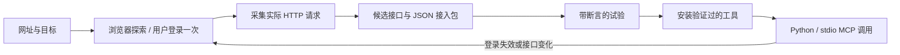

# Web2MCP

[](https://github.com/xuexying/web2mcp/actions/workflows/ci.yml)
[](LICENSE)
[](pyproject.toml)

**在浏览器里录制一次，之后不用浏览器也能一直调用。**

把你已经登录在用的 Web 产品变成 MCP 工具。默认只读；写入需要经过审查的契约。

[English](README.md) | 简体中文

```sh
pip install git+https://github.com/xuexying/web2mcp
web2mcp inspect site.har
web2mcp discover site.har --out my-profile --origin https://api.example.com --read-only-safe
```

- **调用时不需要浏览器。** 工具直接发送从录制中学到的 HTTP 请求；浏览器只用于探索、登录和重新验证。
- **写入有护栏。** 每次写入先预览、需显式批准、提交后回读服务端验证业务结果，并有持久化的重复提交锁。
- **"捕获到"不等于"验证过"。** 观察到的请求只是候选；工具要通过带断言的试验后才发布。

> 请勿与 [WebMCP](https://github.com/webmachinelearning/webmcp) 混淆——那是让**网站作者**在页面内暴露工具的 W3C 标准草案。Web2MCP 从外部工作，基于你有权使用的站点的录制流量，不需要网站配合。

## 工作流程



采集器记录实际发生的交互，接入包描述调用方法，执行器负责按约束发送和验证。自动接入层只负责调度这套流程，不允许模型生成任意代码后直接执行。

## 怎么导出 HAR

在任意浏览器里登录目标站点、操作几下，然后保存流量：

- **Chrome / Edge**：开发者工具 (F12) → Network 面板 → 右键任意请求 → *Save all as HAR with content*。
- **Firefox**：开发者工具 → 网络 → 齿轮 ⚙ → *全部保存为 HAR*。
- **Safari**：先启用"开发"菜单，然后 开发 → 显示 Web 检查器 → 网络 → *导出*。

**手机 App 和桌面 App**（不只是浏览器）：让 App 走 [mitmproxy](https://mitmproxy.org/) 代理并信任其 CA 证书，然后导出 HAR（`File → Export → HAR`，或用 `mitmweb`/`mitmdump` 加 `--save-har out.har`）。mitmproxy 导出的是标准 HAR 1.2，`web2mcp quick` / `discover` 直接能吃——所以手机 App 或 Electron 桌面 App 和网站是同样的接入方式。只抓你有权自动化的 App 和账号。

HAR 带着你的登录态（Cookie），请把它当作凭据文件保管，不要提交进版本库。

## 你会得到什么

对采集文件执行 `discover` 会生成一个私有 profile 目录，包含：

- **一个 MCP 服务**（`web2mcp serve <profile>`，stdio 传输）和可直接粘贴的 `mcp.json`。
- **生成的 Python 客户端**（`client.py`），每个操作一个方法。
- **OpenAPI 3.1 规格**（`openapi.json`），描述观察到的接口面，含读写标注和 RPC 变体。
- **哈希链本地审计日志**，记录每次调用，敏感值已脱敏。

## 先跑一个完全本地的演示

```sh
git clone https://github.com/xuexying/web2mcp.git
cd web2mcp
python3 -m venv .venv && source .venv/bin/activate
python -m pip install -e '.[test]'
python examples/demo.py --verbose
python -m pytest -q
```

演示会启动仅监听 `127.0.0.1` 的虚构采购系统，生成请求样本，创建临时 profile，再通过真正的 MCP stdio 连接完成读取、预览、一次批准、回读及重复提交拦截。数据全部虚构，不使用真实 AI 或浏览器。

## 接入方式

### 方式一：一条命令录制（`web2mcp record`）

从网址到只读 MCP 的最短路径，macOS / Linux / Windows 都能用。需要可选的录制组件：

```sh
pip install 'web2mcp[record]'
playwright install chromium
web2mcp record https://app.example.com --out work/site
```

会弹出一个 Chromium 窗口；登录并点开你关心的页面，然后**关闭窗口**即结束。录到的流量变成 `work/site/capture.json`，`record` 会打印每来源概览和可直接粘贴的 `discover` 命令。密码和验证码由你在窗口里手动输入——任何含密码类字段的请求在落盘前就被丢弃，原始录制文件转换后即删除。然后：

```sh
web2mcp discover work/site/capture.json \
  --out work/site-profile --origin https://api.example.com --read-only-safe
web2mcp serve work/site-profile
```

### 方式二：导入 HAR（stable）

任意操作系统、任意浏览器，完全不依赖额外工具。仅使用你有权限操作的站点和账号。

**最快路径 —— `web2mcp quick`：** 一条命令完成 inspect、自动选 API origin、产出安全只读 profile 并打印可直接粘贴的 MCP 配置。只有一个明确的 API origin 时自动进行；有多个候选时停下来让你用 `--origin` 选：

```sh
web2mcp quick work/site.har
```

想一步步来？不确定该填哪个 `--origin`？`inspect` 会列出每个来源的接口数、读写分布、是否带登录，并给出可直接粘贴的 `discover` 命令（第三方/分析域会被标记并排除）：

```sh
web2mcp inspect work/site.har
```

一步产出**安全只读** MCP——只暴露读工具，写操作隐藏且被执行层拦截（`read_only_mode`）：

```sh
web2mcp discover work/site.har \
  --out work/site-profile --origin https://api.example.com --read-only-safe
web2mcp serve work/site-profile
```

HAR 导入会从请求/响应头重建 cookie 快照，**登录态随 HAR 一起带入**。可加 `--policy examples/policy.json`（按实际接口修改）为工具命名并显式标注读写语义；HTTP 方法本身不足以判断读写，带副作用的路径（logout/export/approve/…）不会被自动归为只读。

要开启写入：审查语义后，用 `trial-read` / `publish-reads`，或接入包流程 `draft-pack` → `check-pack` → `trial-pack` → `install-pack`，并安装经过审查的写入契约。完整命令见 [docs/INTEGRATION.md](docs/INTEGRATION.md)，接入包语法见 [web2mcp/pack_reference.md](web2mcp/pack_reference.md)。

### 方式三：让 AI 驱动浏览器探索（experimental）

需要浏览器后端，用 `--backend` 选择（默认 auto）：

- `playwright` — 内置 Chromium，跨平台（`pip install 'web2mcp[record]'`）。
- `ego` — [ego-browser](https://github.com/citrolabs/ego-lite)（可选；免费；macOS 和 Windows）。
- `cdp` — 连接你用 `--remote-debugging-port=9222` 启动的 Chrome，复用其现有登录态。

```sh
python -m web2mcp explore-start work/exploration \
  --url https://example.com --backend playwright \
  --goal '读取任务列表和详情，验证两个不同任务'
python -m web2mcp serve-explorer work/exploration
```

外部 AI 通过受限动作观察页面、执行经审阅的有界 UI 操作、起草候选配置、运行试验并安装工具。登录由你在浏览器里完成，程序不接收密码或验证码。`source-map` / `explore-survey` / `synth-profile` 可以从应用自身发布的 JavaScript 加运行时采集测绘接口面；合成的 profile 默认 `read_only_mode`。（HAR 路径和 `web2mcp record` 完全不需要后端。）

### 方式四：自动接入服务（experimental——尚未在真实网站验证）

本地 HTTP API 接收网址和目标；可配置模型规划探索、试验、提问和发布。循环和安全门禁有模拟模型的测试覆盖，但**还没有真实模型在真实网站上端到端跑通过**——见 [ROADMAP.zh-CN.md](ROADMAP.zh-CN.md)。

```sh
cp model.example.json model.local.json   # 配置模型地址；API 密钥放 WEB2MCP_MODEL_API_KEY 环境变量
python -m web2mcp serve-integrations work/integrations \
  --model-config model.local.json --port 8766
```

服务只监听 `127.0.0.1` 且要求本地令牌（启动时输出路径）。需要登录、业务选择或具体写入授权时，任务进入 `waiting_user`。

| API | 用途 |
| --- | --- |
| `POST /v1/integrations` | 创建接入任务 |
| `GET /v1/integrations/{id}` | 查看进度与待回答问题 |
| `POST /v1/integrations/{id}/responses` | 回答问题或批准具体操作 |
| `POST /v1/integrations/{id}/pause` · `/resume` | 当前步骤结束后暂停；带预算恢复 |
| `GET /v1/integrations/{id}/mcp-config` | 取得已验证工具的 MCP 配置 |

## 连接 MCP 或 Python

每个 profile 自带 `mcp.json`；也可以手动配置：

```json
{
  "mcpServers": {
    "my-product": {
      "command": "/absolute/path/to/.venv/bin/python",
      "args": ["-m", "web2mcp", "serve", "/absolute/path/to/profile"]
    }
  }
}
```

```python
from web2mcp import Product

with Product("work/site-profile") as product:
    print(product.tools())
    result = product.call("my_product__read", {"id": "123"})
```

## 边界与负责任的使用

**仅在你有权自动化的站点和账号上使用 Web2MCP。** 请确认目标产品的服务条款；有官方 API 时优先使用官方 API。

- 遇到反自动化防护（验证码、工作量证明、设备绑定）时，正确的行为是识别、停止，并告诉你此站点当前方式不支持——而不是绕过。
- 捕获文件可能包含凭据和业务正文。profile、会话、诊断和审计都是本地私有运行数据，不要提交（自带的 `.gitignore` 已覆盖默认情况）。
- 配置模型后，探索上下文中的页面内容和业务样本可能发送给该模型服务。请使用你信任的模型环境。
- 写入不自动重试。超时或结果不明确时保留状态并停止；重复提交锁不能替代上游服务的幂等保证。
- 凭据会过期。重新采集后执行 `refresh-login` / `refresh-storage`，实时身份探针通过后才更新凭据。不提供任意站点的自动令牌续期，未知签名不会按旧值直接重放。
- Windows 上凭据文件的保护依赖用户目录 ACL，而非 POSIX `0600` 权限。
- 未内置：站点专用签名算法、WebSocket 协议、文件上传、流式响应。这些需要经审查的适配器扩展。

## 目录

```text
web2mcp/          执行器、发现、契约、浏览器桥接和任务调度
examples/         虚构本地产品、端到端演示和 JSON 接入包示例
tests/            不使用生产账号的回归测试
docs/             接入指南和演示素材
model.example.json  不含密钥的模型配置模板
```

## 许可证

[MIT](LICENSE)。
