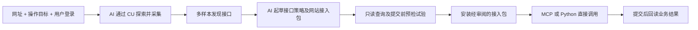

# Web2MCP 0.3：可复用的网站接入包

换网站时，常规 HTTP 产品可以主要补两份 JSON：接口识别策略 `policy.json` 和网站接入包 `product.pack.json`。认证资料留在每个网站独立的私有 profile。执行器、Python 调用入口和 MCP 服务复用同一套代码。

目前是可运行、已通过隔离测试的通用框架原型。连接它的 AI 负责理解页面、规划探索和编写接入包；框架负责采集、验证和执行。覆盖范围以实际探索并验证过的操作为准。

## 新网站到底要补什么

| 内容 | 常规接入方式 | 需要写 Python 的情况 |
|---|---|---|
| 登录及请求认证 | 用户登录一次；采集 Cookie、Bearer 或静态请求头；已有 ND MAC 适配器可复用 | 新的动态签名、设备证明或其他未知认证机制 |
| 哪个请求表示哪个动作 | `policy.json` 配置工具名、读写性质、RPC 分流条件 | 未支持的网络协议，例如 WebSocket、二进制 RPC |
| 输入和返回字段 | 接入包中的参数 schema、字段映射和输出 schema | 超出当前表达式能力的特殊解析、二进制附件处理 |
| 业务流程 | 接入包定义多个读取步骤、一次写入、状态固定值、必填字段及回读验证 | 多次写入组成的事务、补偿流程、复杂产品专属计算 |
| CSRF | 已支持 Cookie → `X-CSRF-Token` / `X-XSRF-Token` / `CSRF-Token` 请求头，可对 Cookie 值 URL 解码 | Token 只存在 HTML、JS 或特殊加密响应中的机制 |

典型情况下是“新建配置包”，无需为每个网站新增一个 Python 类。业务含义仍需 AI 根据页面、帮助文档和实际请求判断，例如“确认知悉”和“审批通过”不能仅凭按钮名称混用。

## 接入流程



本次扩展了探索 MCP 的 `explorer_revise_policy`、`explorer_draft_pack`、`explorer_trial_pack`、`explorer_install_pack`，因此接入包的起草、试验和安装也可由已连接的 AI 完成。原有浏览器探索工具继续使用。

1. 用原有 `explore-start` / `serve-explorer` 完成目标范围内的探索，或导入自己合法取得的 HAR / capture。
2. AI 审阅请求含义，写接口策略。`explorer_revise_policy` 将修订策略生成到新的私有草稿目录，保留之前的配置和测试记录；后续探索工具使用新草稿。POST 查询必须显式标记为只读；共用一个 URL 的 RPC 必须按请求体操作名拆分。
3. 用 `draft-pack` 起草接入包，然后补齐业务字段映射、预检及回读条件、测试参数和预期结果。
4. `trial-pack` 只执行读取和提交前预检，不发送业务写入。有输入字段的工具必须提供至少两组不同参数，避免把录制时的单据 ID 写死。
5. `install-pack --reviewed` 核对接入包和接口定义与成功试验时一致，再原子安装。重连生成的 MCP 服务即可发现新工具。
6. 写入按 `prepare → submit → status` 执行。准备阶段显示完整业务参数，提交时再次核对业务状态，并回读真实结果；结果不确定时不自动重试写入。

`--reviewed` 表示接入包的动作含义和读写分类已经过检查，不是批准其中所有未来业务决定。当前用户的任务授权仍决定可以提交哪些动作。

## 命令示例

下面的路径和域名为占位示例，需要替换成新网站的实际私有配置目录。先从项目目录安装 `python -m pip install -e '.[test]'`。

```sh
python -m web2mcp discover /private/path/capture.json \
  --out /private/path/product-profile \
  --origin https://api.example.com \
  --policy /private/path/policy.json

python -m web2mcp draft-pack /private/path/product-profile \
  --name my_product --out /private/path/product.pack.json

# AI 根据业务目标编辑接入包后：
python -m web2mcp check-pack /private/path/product-profile /private/path/product.pack.json
python -m web2mcp trial-pack /private/path/product-profile /private/path/product.pack.json
python -m web2mcp install-pack /private/path/product-profile /private/path/product.pack.json --reviewed
python -m web2mcp serve /private/path/product-profile
```

`draft-pack` 是机械草稿：它不会假装知道业务规则，测试用例初始为空，不能直接发布。一次接入包支持最多 40 个读取配方/写入契约、100 个接口绑定，每个读取配方最多 20 个步骤；应按实际目标删选候选接口。可安装多个独立命名的包。

旧版直接 `discover` 生成的原始工具保持原来的可见性；探索流程生成的候选默认隐藏。安装接入包不会自动撤销已发布原始工具的可见性。新产品建议通过探索草稿发布经验证的业务工具。

## 接入包能表达什么

完整可运行样例：

- [REST 接入包](examples/packs/rest.pack.json) · [接口策略](examples/packs/rest.policy.json)
- [RPC 接入包](examples/packs/rpc.pack.json) · [接口策略](examples/packs/rpc.policy.json)
- [旧式表单接入包](examples/packs/form.pack.json) · [接口策略](examples/packs/form.policy.json)

接入包只绑定已观察到的工具名，不内置账号密码或自行扩展访问域名。读取配方把多个请求组合成一个有业务意义的 MCP 工具，输出通过 JSON Schema 校验。契约沿用已有的一次提交、状态校验和本地结果记录。

| 表达式 | 用途 |
|---|---|
| `$arg`、`$step` | 从工具输入或之前步骤的结果中取字段，使用 JSON Pointer |
| `$get` | 可选字段缺失时提供明确默认值 |
| `$map`、`$item` | 遍历子表，转换每一行字段，最多 1000 行 |
| `$if`、`eq` | 条件字段映射；分支按需求值 |
| `add`、`multiply`、`sum`、`number`、`round` | 基础数字转换和计算 |
| `concat`、`join`、`string`、`coalesce` | 字符串组合和空值处理 |
| `date_add_days` | 明确输入 ISO 日期并加天数，不读取系统“今天” |
| `json` | 把对象/子表序列化成旧式表单需要的 JSON 字符串 |
| `$literal` | 转义包含 `$` 的普通数据 |

表达式没有 `eval`、脚本执行、文件读取或联网能力。未知函数、前向步骤引用、错误类型和超出工作预算会明确失败。基础数字运算采用 Python 浮点，`round` 使用 Python 舍入规则；精确财务金额应使用整数最小货币单位或另行实现并验证 Decimal 规则。

例如，计划完成日期：

```json
{"$fn": "date_add_days", "args": [{"$arg": "/start"}, 30]}
```

子表合计：

```json
{
  "$fn": "sum",
  "args": [{
    "$map": {"$step": "before", "pointer": "/data/ticket/lines"},
    "value": {"$fn": "multiply", "args": [{"$item": "/quantity"}, {"$item": "/price"}]}
  }]
}
```

## RPC 及动态会话

RPC 查询和写入经常共用 `POST /rpc`。策略可把不同的 `/method` 值识别成不同工具：

```json
{
  "POST /rpc": {
    "variants": [
      {"match": {"/method": "task.get"}, "name": "detail", "read_only": true},
      {"match": {"/method": "task.decide"}, "name": "decide", "read_only": false}
    ]
  }
}
```

每个分支必须有真实采集样本，分流条件不能重叠。运行时固定分流字段，不能把 `detail` 的参数改成 `task.decide` 来绕过写入分类。OpenAPI 输出同时保存这些变体。

CSRF 使用当前 HTTP 会话中、与目标 URL 的域和路径匹配的 Cookie。提交前读取操作收到的新 Cookie 会自动用于后续请求，不把临时 Token 放进业务预览。缺少匹配 Cookie 时会阻止发送，不退回录制时的旧请求头。此机制不包含自动刷新 OAuth 或破解验证码。

## 同一套工具通过 Python 调用

```python
from web2mcp import Product

with Product('/private/path/product-profile') as product:
    print(product.tools())
    record = product.call('rest_demo__read', {'id': '101'})
    preview = product.call('rest_demo__approve_prepare', {
        'id': '101', 'note': '已核对', 'start': '2026-10-23'
    })
    # 仅在当前任务授权覆盖此动作时提交：
    result = product.call('rest_demo__approve_submit', {
        'preview_id': preview['preview_id'], 'confirm': True
    })
    print(result['business_verified'])
```

`Product` 与 MCP 服务使用同一组已发布工具。底层 `Client` 仍保留为开发和诊断接口。登录失效后，沿用原有登录恢复及身份核验机制；写入不会自动重放。

## 本轮验证范围

三个本机隔离 HTTP 测试站分别采用 REST + Bearer、同 URL 的 JSON RPC + 自定义认证头、表单编码 + Cookie + 每次读取轮换的 CSRF。三个网站的接入差异全部在 JSON 策略和接入包里，没有为它们编写不同的运行时 Python 适配器。

每个站点验证两条不同记录，经过标准 MCP stdio 客户端完成查询、预览、提交、业务结果回读，共 6 次测试审批；接入包试验阶段零业务写入。还覆盖状态变化阻断、接口定义和接入包变更、只读/写入混淆、字段允许列表、CSRF 域范围、输出类型错误、映射预算及原有适配器回归。

这轮 HTTP 样本由测试客户端对隔离站点实际发请求产生，没有重新跑浏览器 CU；它验证的是“采集后的泛化执行”阶段。浏览器探索端到端的历史证据见 [V2_GUIDE.md](V2_GUIDE.md)。本轮没有对新的真实第三方网站完成接入，也没有操作生产单据。

测试命令和最终数量见 [V3_TEST_REPORT.md](V3_TEST_REPORT.md)。

## 仍需扩展的边界

未知签名、图形验证码后的会话续期、文件上传下载、流式/二进制协议、多写入补偿事务，以及任意产品页面中的复杂 JS 校验，仍需专门支持。通用自动分页和任意 GraphQL 查询解析也尚未实现；目前可以把已观察的固定分页请求或 JSON 操作分流写入配置。

事务池和会议的现有专用适配器保持兼容；没有把历史上所有私有业务脚本自动转换成接入包。新框架提供了逐步迁移的共同执行基础。
